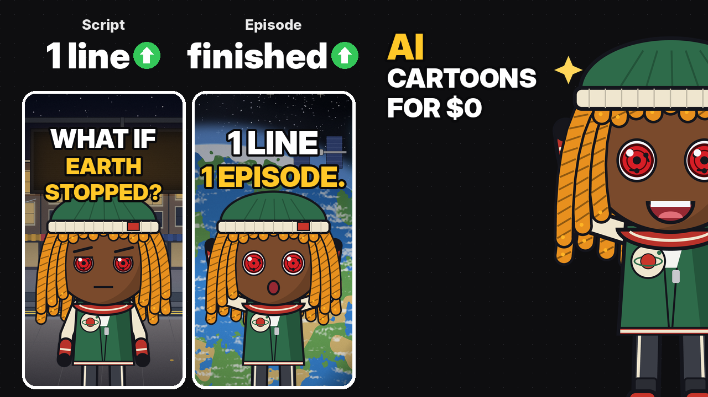

# Shamz agent skills



Skills for AI coding agents: folders of instructions, scripts and code that teach an agent one job from start to
finish. They work in Claude Code and OpenCode directly, and in any agent that reads `AGENTS.md` (Codex, Cursor,
Aider, Gemini CLI and others).

## Skills

| Skill | What it does | Needs |
|---|---|---|
| [shamz-what-if](skills/shamz-what-if/) | One topic line in ("What if you could rewind 10 seconds?"), a finished 15-25 s stick-figure "What If" episode out, starring Shamz with a cast of 80: script, voice, storyboard with a self-check, animation in code (Remotion), sound, mastering to -14 LUFS | Node 18+, Python 3.9+ (numpy, pillow), ffmpeg, an ElevenLabs API key |


## Install

The quickest way: paste the prompt in [SETUP_PROMPT.md](SETUP_PROMPT.md) into your agent, from the folder you want
to work in. It clones this repo, runs the installer, installs what's missing and asks you for your keys.

Or by hand, from your project folder:

```bash
git clone --depth 1 https://github.com/shamz4200/agent-skills /tmp/agent-skills
bash /tmp/agent-skills/install.sh .
```

```powershell
git clone --depth 1 https://github.com/shamz4200/agent-skills $env:TEMP\agent-skills
powershell -ExecutionPolicy Bypass -File $env:TEMP\agent-skills\install.ps1 .
```

The installer puts each skill in `.claude/skills/<name>/`, its start commands in `.claude/commands/` and
`.opencode/commands/`, lists the
skills in `AGENTS.md`, creates an empty `.env` and adds `.env` to `.gitignore`. It is safe to re-run; re-running
updates the skills.

## Make your first cartoon

Start your agent **from inside your project folder** (where you ran the installer), type `/what-if` or `/shamz`
and your idea as a What If question, press Enter and leave it running:

```
/what-if What if you could see one minute ahead?
```

```
/shamz What if you could pause everyone but you?
```

It writes the script, voices it, draws a storyboard and fixes it, animates every shot in code and adds the sound.
The finished episode lands in `what-if-studio/out/<episode>/`. The first run also sets up the studio, which adds a
few minutes.

- **Claude Code and OpenCode:** `/what-if` and `/shamz` are real slash commands.
- **Other agents (Codex, Cursor, Aider, Gemini CLI):** type the same line; `AGENTS.md` tells them what it means.
- **Tips:** start a fresh session for each cartoon; give notes in plain words ("the ball in shot 3 covers his face")
  and it fixes and re-renders that shot; open the source of the episode's one real fact before you post.

## Use

- **Claude Code:** start it in the project folder and type `/what-if` or `/shamz` and your idea, or just ask:
  "Make a Shamz What If episode: what if you could pause everyone but you?"
- **OpenCode:** start it in the project folder and type `/what-if` or `/shamz` and your idea
- **Other agents:** they find the skills through `AGENTS.md`; ask for the task in plain words.

## Keys

Keys go in the project's `.env` (for example `ELEVENLABS_API_KEY=...`), never in this repo, a prompt or a commit.

## Adding a skill

Add a folder under `skills/` with a `SKILL.md` (front matter `name` and `description`, then the steps), plus any
`references/`, `scripts/` and `opencode/commands/`. The installers pick it up automatically.

## Licences

MIT. Each skill folder keeps its own `LICENSE`, which must stay with its files; see [LICENSE](LICENSE) for the rest
of this repo.
