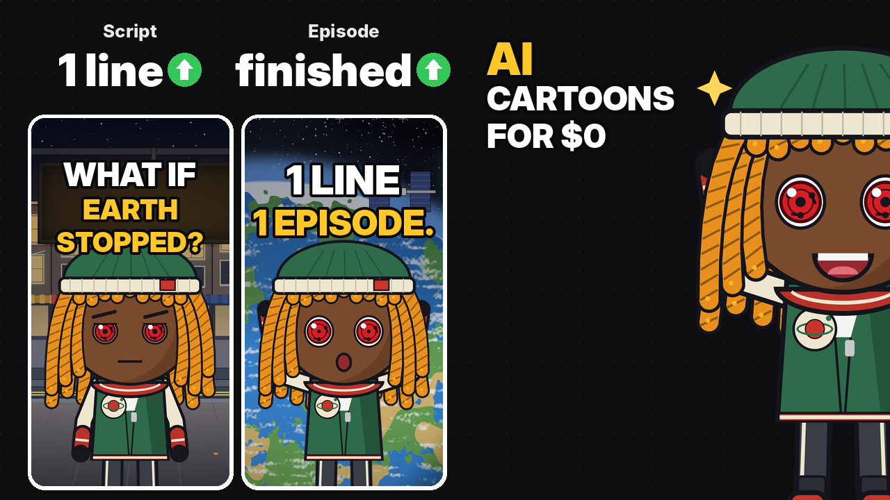
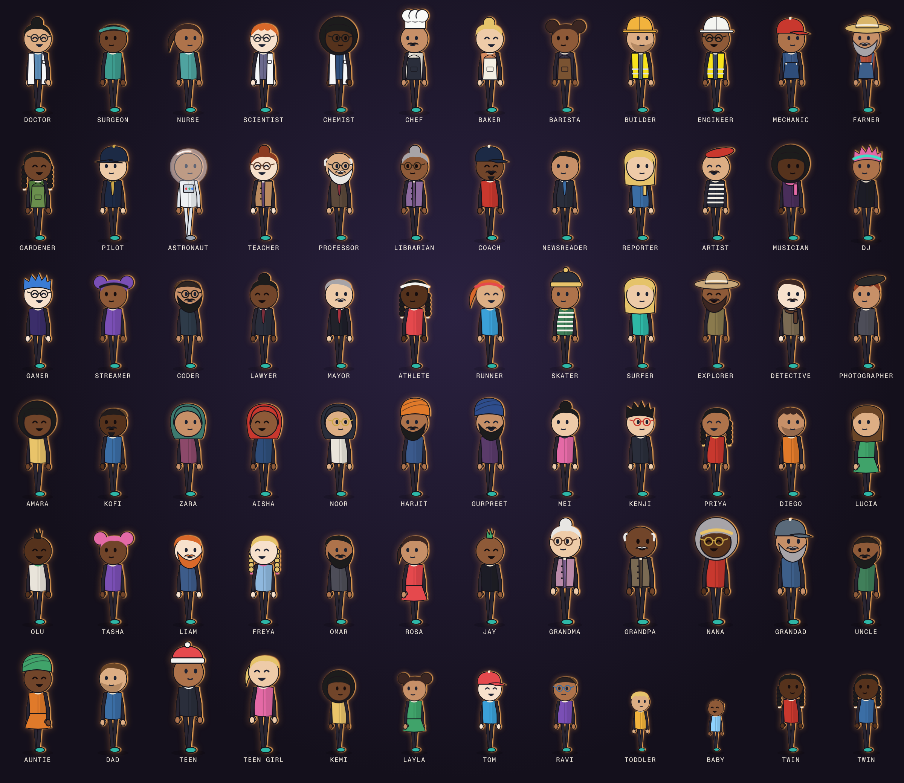

# Shamz agent skills



Skills for AI coding agents: folders of instructions, scripts and code that teach an agent one job from start to
finish. They work in Claude Code and OpenCode directly, and in any agent that reads `AGENTS.md` (Codex, Cursor,
Aider, Gemini CLI and others).

## Skills

| Skill | What it does | Needs |
|---|---|---|
| [shamz-what-if](skills/shamz-what-if/) | One topic line in ("What if you could rewind 10 seconds?"), a finished 15-25 s stick-figure "What If" episode out, starring Shamz with a cast of 80: script, voice, storyboard with a self-check, animation in code (Remotion), sound, mastering to -14 LUFS | Node 18+, Python 3.9+ (numpy, pillow), ffmpeg, and an ElevenLabs API key, or the free Chatterbox route (your own voice, cloned locally) |
| [ab-render-tool-comparison](skills/ab-render-tool-comparison/) | Builds the same timed cut in two tools, records hashes and render/authoring times, frame-inspects both, and lets the human eye overrule speed | Two tools able to build the same cut, identical source material, a way to hash outputs and inspect frames |
| [animated-dialogue-podcast-rebuild](skills/animated-dialogue-podcast-rebuild/) | Rebuilds an animated dialogue podcast episode end to end, from script to SHA-bound approved file | Show format, locked voices/outfits/character sheets, loudness gate, logo asset |
| [character-sheet-qc](skills/character-sheet-qc/) | Checks every generated still and thumbnail against its locked character sheet, one still at a time, zoomed in, plus multi-timestamp clip checks and aspect-ratio verification | The locked character sheet per character, the generated stills and clips, the delivery aspect ratio |
| [claim-counter-flag-research](skills/claim-counter-flag-research/) | Researches disputed topics keeping every claim with its counter-flag beside it | A topic and its starting sources |
| [code-rendered-vertical-short](skills/code-rendered-vertical-short/) | Builds a vertical story short in code, from approved script to frame-QA'd file for verdict. Needs a proving run (3D bridge-world step unproven) | Approved script, locked character parameters, narrator voice, bridge template |
| [cross-channel-learnings-board](skills/cross-channel-learnings-board/) | Harvests lessons from every chat the same day, verifies each against its source, files dated board entries, and folds durable ones into the rules | A protected folder (board, rules file, review log, state file), access to the source chats and files, a weekly review slot |
| [daily-aaa-motion-research](skills/daily-aaa-motion-research/) | Studies the best motion websites daily against a locked design vision and writes delta-only notes, split PROVEN vs SPECULATION, ending with one testable step. Research only, never builds | A locked design vision file, a dated folder of past notes, web search access |
| [daily-carousel-system](skills/daily-carousel-system/) | Builds three carousel sets a day (market, wisdom, or story) with a duplicate guard and live verification, then mirrors them to a second surface | Lane parameters (surfaces, brand kit, price feed), the used-content log, the locked character sheet or art, a verified sign-in |
| [disk-quota-guard](skills/disk-quota-guard/) | Detects a disk quota failure with a small test write instead of trusting free-space readings, then recovers the stalled build without deleting anything locked | The build state file, the keep lock list, a way to run a small test write |
| [final-master-audio-qc](skills/final-master-audio-qc/) | Upmixes mono narration to stereo before the mux, measures both channels separately, and scans the exact final file for silent gaps. Loudness alone never passes | The exact final file, narration chunk durations and slots, a silence detector and per-channel volume measurement |
| [full-packaging-mirror-checklist](skills/full-packaging-mirror-checklist/) | The moment a video goes live: playlist, pinned comment, exactly one Community post, captions/thumbnails/titles verified live, then mirrors to Instagram and TikTok with the same caption | The live video URL, title, description and thumbnails, the mirror caption, verified signed-in access per destination |
| [live-verified-media-strip](skills/live-verified-media-strip/) | Frees disk space safely: verifies a video is live from four sources first, then strips only its masters and segments, keeping scripts, logs, captions and thumbnails | Publish records, upload logs and drop logs, memory search access, a workspace state file |
| [manual-deploy-workflow](skills/manual-deploy-workflow/) | Deploys a web app with auto-deploy off: check, upload by hand, manual deploy, verify live, roll back by re-upload | A deploy tree with no local repo in it, code host repo + hosting service + app URL, hosting dashboard access |
| [meme-coin-intel-scan](skills/meme-coin-intel-scan/) | Scans meme culture first, then the token, then the trench, and reports a verdict-first answer to nine fixed questions. Education only, never recommends buying. Needs a proving run (last live scan Oct 10) | Public culture sources, public token-screening sources, workspace folders for dated reports and weekly reviews |
| [narrated-animated-block-pipeline](skills/narrated-animated-block-pipeline/) | Builds a narrated animated episode one block at a time, with approval at every stage so nothing bad reaches the next stage | Locked character sheets and world look, approved script, checkpointed voice pipeline |
| [narrated-block-shot-list-gates](skills/narrated-block-shot-list-gates/) | Gates a shot list on measured narration rate, story-only narration, and varied camera angles before any stills or narration are made | Timed narration transcript, shot list with verb and camera columns |
| [narrated-episode-pipeline](skills/narrated-episode-pipeline/) | Takes a narrated episode from script to live and fully packaged | Series bible, previous episode's cliffhanger, locked narrator voice, drop surface |
| [packaging-placeholder-scan](skills/packaging-placeholder-scan/) | Scans every packaging text for unresolved bracketed placeholders before it goes live | The exact files that will publish, real links and text |
| [protected-folder-channel-bible](skills/protected-folder-channel-bible/) | Holds a whole channel in one protected folder, so the channel can be rebuilt at the same quality from that folder alone | Workspace folder, locked bibles and sheets, weekly review slot |
| [publish-preflight-check](skills/publish-preflight-check/) | Verifies every publishing destination and its sign-in route before any packaging set is built | Ordered account handle and route per destination |
| [restart-proof-build-continuity](skills/restart-proof-build-continuity/) | Keeps every long build restart-proof with a state file, chunked builds, a protected folder, and a 10-minute idle watchdog | Workspace state file per job, checkpointed chunks, watchdog |
| [script-aware-loop-check](skills/script-aware-loop-check/) | Catches repeated phrases in a narration transcript without flagging scripted repetition or numbers spoken in different forms | Timestamped transcript, script, original suspect report |
| [segment-audio-hygiene](skills/segment-audio-hygiene/) | Assembles multi-chunk narration without DC bursts, drift, or gaps | Narration chunks and timed transcript, expected beat total |
| [shamz-gta-quick-guide](skills/shamz-gta-quick-guide/) | Makes the daily batch of 6 GTA 6 tip and news Shorts with Shamz as host: verified topics, the owner's voice, new images with his red tomoe eyes, motion graphics, music, and same-named thumbnail and SEO upload packs | The owner's voice sample and music, Cloudflare Workers AI (paid), Node, Python, ffmpeg |
| [shamz-thumbnail-method](skills/shamz-thumbnail-method/) | Builds thumbnails on a fixed per-channel template, tested by watch time | Episode premise, locked character sheet, channel thumbnail system file |
| [shamzclipz](skills/shamzclipz/) | Cuts Shorts from your own livestream VODs in the Shamz funny-caption format | A VOD link from your own stream, Python 3.12, ffmpeg, the finder engine |
| [shot-narration-match](skills/shot-narration-match/) | Gates a narrated block on per-shot narration match, group shots, and one locked location before any stills are made | Narrator text per shot, shot list with location lock, character sheets |
| [single-voice-run](skills/single-voice-run/) | Runs one voice synthesis job at a time in small checkpointed chunks so a second run cannot kill the first with out of memory | Episode workdir, narration split into ~50s chunks, memory reading |
| [study-a-video](skills/study-a-video/) | Turns one sent video or post into a structured study with a transferable lesson | A video link or post |
| [weekly-monetization-tracker](skills/weekly-monetization-tracker/) | Tracks monetization progress weekly from a fresh Studio read, charted and logged | Studio read access per channel, chart script, history log |
| [weekly-trend-radar](skills/weekly-trend-radar/) | Scans your niches weekly, grades accelerating trends, keeps the raw evidence | Niche list with search terms, social-data API access |
| [youtube-content-id-dispute-playbook](skills/youtube-content-id-dispute-playbook/) | Files a Content ID dispute on original work and tracks the 30-day clock | Studio access on the right channel, the approved dispute text |



## Install

The quickest way: paste the prompt in [SETUP_PROMPT.md](SETUP_PROMPT.md) into your agent, from the folder you want
to work in. It clones this repo, runs the installer, installs what's missing and asks you for your keys.

Or by hand, from your project folder:

```bash
git clone --depth 1 https://github.com/shamz4200/agent-skills /tmp/agent-skills
bash /tmp/agent-skills/install.sh .
```

```powershell
git clone --depth 1 https://github.com/shamz4200/agent-skills $env:TEMP\agent-skills
powershell -ExecutionPolicy Bypass -File $env:TEMP\agent-skills\install.ps1 .
```

The installer puts each skill in `.claude/skills/<name>/`, its start commands in `.claude/commands/` and
`.opencode/commands/`, lists the
skills in `AGENTS.md`, creates an empty `.env` and adds `.env` to `.gitignore`. It is safe to re-run; re-running
updates the skills.

## Make your first cartoon

Start your agent **from inside your project folder** (where you ran the installer), type `/what-if` or `/shamz`
and your idea as a What If question, press Enter and leave it running:

```
/what-if What if you could see one minute ahead?
```

```
/shamz What if you could pause everyone but you?
```

It writes the script, voices it, draws a storyboard and fixes it, animates every shot in code and adds the sound.
The finished episode lands in `what-if-studio/out/<episode>/`. The first run also sets up the studio, which adds a
few minutes.

- **Claude Code and OpenCode:** `/what-if` and `/shamz` are real slash commands.
- **Other agents (Codex, Cursor, Aider, Gemini CLI):** type the same line; `AGENTS.md` tells them what it means.
- **Tips:** start a fresh session for each cartoon; give notes in plain words ("the ball in shot 3 covers his face")
  and it fixes and re-renders that shot; open the source of the episode's one real fact before you post.

## Use

- **Claude Code:** start it in the project folder and type `/what-if` or `/shamz` and your idea, or just ask:
  "Make a Shamz What If episode: what if you could pause everyone but you?"
- **OpenCode:** start it in the project folder and type `/what-if` or `/shamz` and your idea
- **Other agents:** they find the skills through `AGENTS.md`; ask for the task in plain words.

## Keys

Keys go in the project's `.env` (for example `ELEVENLABS_API_KEY=...`), never in this repo, a prompt or a commit.

## Adding a skill

Add a folder under `skills/` with a `SKILL.md` (front matter `name` and `description`, then the steps), plus any
`references/`, `scripts/` and `opencode/commands/`. The installers pick it up automatically.

## Licences

MIT. Each skill folder keeps its own `LICENSE`, which must stay with its files; see [LICENSE](LICENSE) for the rest
of this repo.

## Styles in the Shamz skill

- **What If Dusk**: the skill's main style (stick-figure cast at dusk, the seven-beat What If formula).
- **Night Dossier ("ND style")**: true-story investigations told at night: bean characters, one warm lamp per scene,
  a camera that never stops, handwritten type-on cards, files, maps and stamps, with Shamz as the investigator.
  Engine, a 60-second example, full-episode tools and a master prompt for any agent:
  [`skills/shamz-what-if/night-dossier/`](skills/shamz-what-if/night-dossier/README.md).
- **Glow style**: second-person research explainers at night: glowing white figures in detailed painted night rooms,
  studies shown as crowds of little people with the citation on screen, captions a phrase at a time, Shamz as "you".
  Engine, background tool, a 60-second example and a master prompt: [`skills/shamz-what-if/glow-style/`](skills/shamz-what-if/glow-style/README.md).
