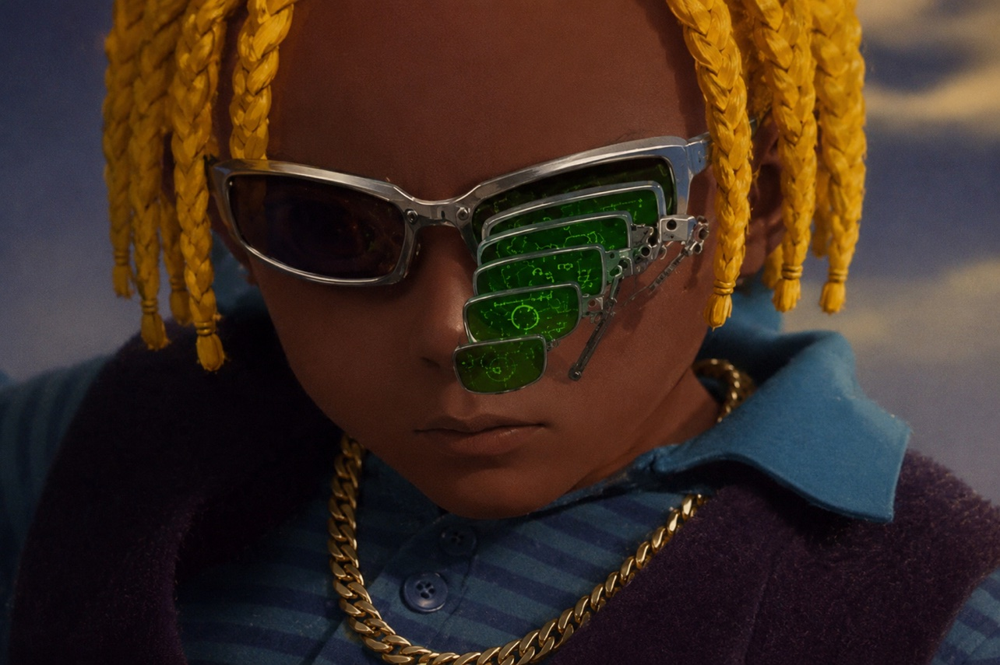

# Shamz A/B Render-Tool Comparison

Two tools could do the same job. Build the same cut in both, with hashes, times, and a frame inspection,
and let the human eye decide.

A $shamz skill, part of the Shamz agent-skills collection. Use it before committing a pipeline to a new render
or production tool, so the decision rests on evidence, not on a demo.



## What it does

1. **Fixes one timed test cut** and builds it in both tools: same content, same timing, same length.
2. **Records content hashes, render time, and authoring time separately.** A fast render with slow authoring
   is not a fast tool.
3. **Frame-inspects both outputs** at the same timestamps, judging picture quality, motion, and artefacts by eye.
4. **Records a verdict** where picture quality overrules speed, and keeps the report with the project so the
   decision is not re-litigated from memory.

## What you need

- Two tools to compare, both able to build the same cut
- Identical source material for both builds
- A way to hash outputs and inspect frames

## Install

From the folder you want to work in, give your agent the prompt in
[SETUP_PROMPT.md](../../SETUP_PROMPT.md), or run the installer yourself:

```bash
git clone --depth 1 https://github.com/shamz4200/agent-skills /tmp/agent-skills
bash /tmp/agent-skills/install.sh .
```

## What's in the folder

| Path | What |
|---|---|
| `SKILL.md` | The method the agent follows |
| `README.md` | This how-to guide |
| `LICENSE` | MIT licence, which must stay with these files |
| `hero.jpg` | The hero image for this skill |

## Rules it follows

- Same cut, same content, same timing. A comparison built on different cuts proves nothing.
- Render time and authoring time are separate numbers. Never merge them.
- The eye overrules the stopwatch.

## Licences

- MIT: see `LICENSE` in this folder, which must stay with these files.
