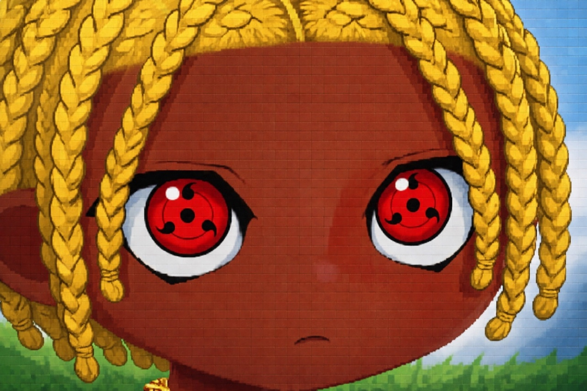

# Character Sheet QC

Every generated still and thumbnail is checked against its locked character sheet before it is passed,
narrated, or assembled. One still at a time, zoomed in, against the sheet — never a sample, never a contact sheet.

A $shamz skill, part of the Shamz agent-skills collection. Characters must look identical to their sheets,
always. That is the whole point of having the sheet.



## What it does

1. **Locks the character sheet as the single source of truth** before generation begins, and records its path
   in the build record.
2. **Inspects every still individually**, zoomed on face, body form, and outfit: eyes, hair, skin tone, key
   accessories, proportions, colours, trim, patches, trousers, shoes.
3. **Checks generated video clips at multiple timestamps** (t=0/2/4/6/8/9 seconds), not just the first frame,
   so mid-clip morphs get caught.
4. **Verifies each still's delivery aspect ratio** before passing it, and never crops a wrong-ratio still to fit.
5. **Rejects failures at the still stage** and rechecks every fix the same way. Only a block whose every still
   has passed its individual check is delivered as a pass.

## What you need

- The locked character sheet file for each character in the build
- The generated stills and clips to inspect
- The delivery aspect ratio for the episode

## Install

From the folder you want to work in, give your agent the prompt in
[SETUP_PROMPT.md](../../SETUP_PROMPT.md), or run the installer yourself:

```bash
git clone --depth 1 https://github.com/shamz4200/agent-skills /tmp/agent-skills
bash /tmp/agent-skills/install.sh .
```

## What's in the folder

| Path | What |
|---|---|
| `SKILL.md` | The skill: front matter plus the full rule list |
| `README.md` | This how-to guide |
| `LICENSE` | MIT licence, which must stay with these files |
| `hero.jpg` | The hero image for this skill |

## Rules it follows

- The locked sheet is the single source of truth; never substitute a generated image for the sheet.
- Never crop a wrong-ratio still to fit, and never send a wrong-ratio still to animation.
- A user-granted exception is recorded as an exception, not as a pass.
- Never claim a full check when only a sample was checked.
- A contact sheet never replaces individual inspection.

## Licences

- MIT: see `LICENSE` in this folder, which must stay with these files.
