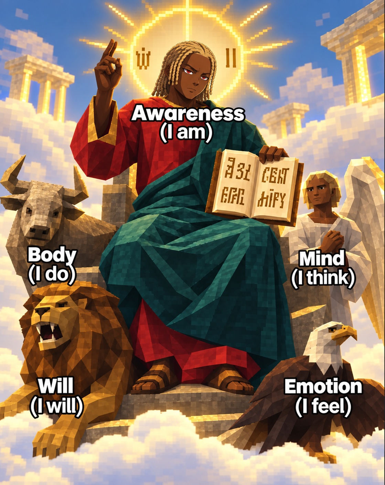

# $shamz Claim and Counter-Flag Research

Research disputed topics without filtering anything out. Every claim is kept in full, with its
counter-evidence flagged beside it, so $shamz can judge for himself.



## What it does

1. **Finds every claim on a topic, from every source,** including disputed and unproven ones.
2. **Keeps each claim in full,** with who said it and its source, and adds a labelled counter-flag beside it
   where counter-information exists.
3. **Labels single-witness claims UNVERIFIED and keeps them,** rather than dropping them for lack of
   corroboration.
4. **Draws connections between claims, people, books, and documents,** labelled by strength, with what would
   strengthen or break each one.
5. **Records unsourced or invented material as a gap,** never as a finding.
6. **Presents the work as scannable cards with status labels,** so the shape of a topic is visible at a glance.

## What you need

- A topic to research and its starting sources
- A place in your workspace to file claims, flags, and connections, dated and sourced
- Access to the sources themselves (videos, books, documents, transcripts) so claims are taken from what they
  actually say

## How a run works

1. Gather the sources and read or watch each one for what it actually says.
2. Record every claim in full with its source, then add counter-flags where counter-information exists.
3. Label each claim CLAIM, COUNTER-FLAG, DISPUTED, or UNVERIFIED, and each connection STRONG, PLAUSIBLE,
   LOOSE, or SPECULATIVE.
4. Restore anything an earlier pass dropped, with its flag, and record the restoration.
5. Present the result as labelled, scannable cards, with full detail underneath.

## Install

From the folder you want to work in, give your agent the prompt in
[SETUP_PROMPT.md](../../SETUP_PROMPT.md), or run the installer yourself:

```bash
git clone --depth 1 https://github.com/shamz4200/agent-skills /tmp/agent-skills
bash /tmp/agent-skills/install.sh .
```

Then start your agent from that folder and give it the topic to research.

## What's in the folder

| Path | What |
|---|---|
| `SKILL.md` | The pipeline the agent follows |
| `README.md` | This how-to guide |
| `LICENSE` | MIT licence, which must stay with these files |
| `hero.jpg` | The hero image for this guide |

## Rules it follows

- Nothing is hidden because it is disputed, unproven, or uncomfortable.
- A counter-claim is never presented as the final verdict, and a claim is never presented as proven fact.
- Single-witness claims are kept and labelled, never dropped.
- No source, no claim: unsourced material is a gap, not a finding.
- The agent finds information and makes connections; $shamz decides what is true.

## Licences

- MIT: see `LICENSE` in this folder, which must stay with these files.
