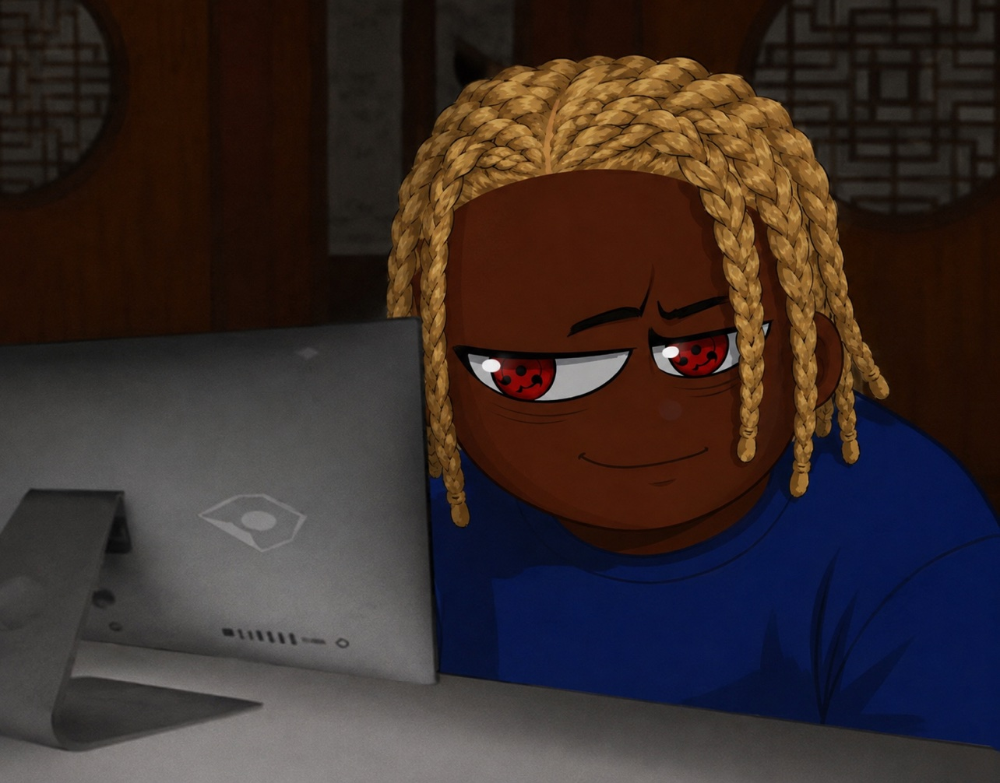

# $shamz Live-Verified Media Strip

Disk space is tight and episode folders are heavy. This skill frees space safely: verify a video is live
from four sources first, then strip only its masters and segments, keeping the scripts, logs, captions,
and thumbnails.

A $shamz skill, part of the Shamz agent-skills collection. Deletion is permanent, so every reply names
exactly what went, what stayed, and the size freed.



## What it does

1. **Runs a fresh whole-machine scan**, headline numbers first, and flags the biggest free-up candidates
   without deleting anything on the scan.
2. **Verifies liveness from four sources in order:** episode folder records, upload-state logs, memory,
   then the platform API. It stops at the first solid record; if no record exists, the episode is treated
   as NOT live.
3. **Treats a HELD label as a gate verdict, never as a liveness record**, and checks the gate's own evidence
   before acting.
4. **Strips a confirmed-live episode's media only**, keeping every core file, and reports exactly what went,
   what stayed, and how much was freed.
5. **Deletes a stale date-bound held episode whole**, once its date has passed and its held status is
   confirmed from the build log.
6. **Cleans extracted frames only after** the delivered videos and the source illustrations are verified.

## What you need

- Publish records, upload logs, and drop logs in your episode folders and upload-state directory
- Memory search access, so a recorded video id and status can count as a liveness record
- A state file in your workspace to resume a multi-folder strip after a restart

## Install

From the folder you want to work in, give your agent the prompt in
[SETUP_PROMPT.md](../../SETUP_PROMPT.md), or run the installer yourself:

```bash
git clone --depth 1 https://github.com/shamz4200/agent-skills /tmp/agent-skills
bash /tmp/agent-skills/install.sh .
```

## What's in the folder

| Path | What |
|---|---|
| `SKILL.md` | The pipeline the agent follows |
| `README.md` | This how-to guide |
| `LICENSE` | MIT licence, which must stay with these files |
| `hero.jpg` | The hero image for this skill |

## Rules it follows

- No deletion without $shamz's explicit word for that item, after verification and the what's-left overview.
- Never delete on an assertion alone; the record wins when record and assertion disagree.
- A HELD label never settles liveness on its own.
- Sound libraries and core files are never deleted by a strip.
- Deletion is permanent, so every reply names exactly what went, what stayed, and the size freed.

## Licences

- MIT: see `LICENSE` in this folder, which must stay with these files.
