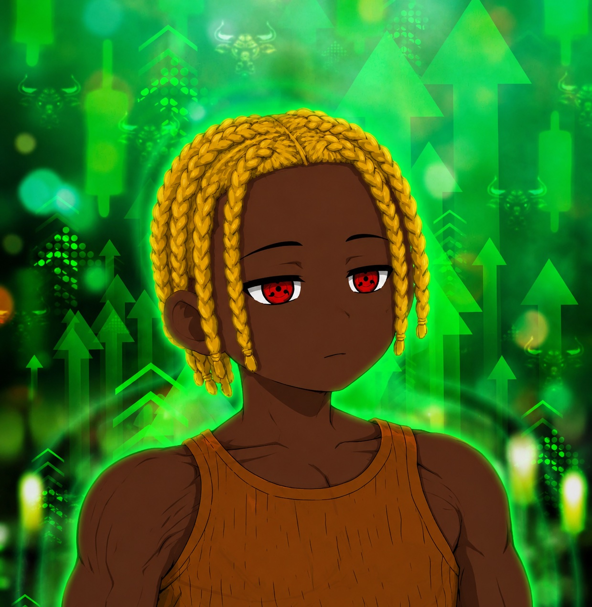

# $shamz Meme-Coin Intel Scan

Scans meme culture first, then the token, then the trench, and reports a verdict-first answer to nine
fixed questions. Education and intelligence only: it never recommends buying.

A $shamz skill, part of the Shamz agent-skills collection.

> **Status: needs a proving run.** This skill has not yet had a live proving run — its last live scan was
> October 10 — so it is not yet proven publish-ready. Treat the method below as unproven until a fresh live
> scan has run end to end and its results have been checked.



## What it does

1. **Scouts culture first** for newly accelerating memes, sounds, moments, and slang, prioritising
   acceleration over absolute size.
2. **Checks tokens only for the strongest cultural candidates**, using the contract address as the primary
   identifier.
3. **Screens each qualifying token in the trench:** wallet quality, holder distribution, developer history,
   bundling, liquidity, momentum, social validation, and manipulation.
4. **Writes a verdict-first report** with one signal block per qualifying signal, watch items, dedup notes,
   and answers to nine fixed questions.
5. **Applies the no-signal rule honestly:** if nothing genuinely early is developing, it says so.
6. **Marks anything older than 7 days STALE**, and restarts after dormancy with a fresh baseline scan.
7. **Reviews weekly**, counting reports first, naming any zero-scan gap, and escalating a long dormancy
   instead of backfilling it.

## The nine questions

Every scan answers all nine:

1. What is becoming culturally important right now?
2. How quickly is it accelerating?
3. Has crypto discovered it yet?
4. Has it been tokenised?
5. Which contracts are actually capturing attention?
6. Is that activity organic or manufactured?
7. What does the blockchain data reveal?
8. What could invalidate the narrative?
9. Are we genuinely early, or does it merely feel early?

## What you need

- Public culture sources: trend and editorial feeds, news, social search, and short-form trend coverage
- Public token-screening sources for the primary chain you track, plus launchpad and trending-token feeds
- A folder in your workspace for dated scan reports and raw payloads, and a folder for weekly reviews

## Install

From the folder you want to work in, give your agent the prompt in
[SETUP_PROMPT.md](../../SETUP_PROMPT.md), or run the installer yourself:

```bash
git clone --depth 1 https://github.com/shamz4200/agent-skills /tmp/agent-skills
bash /tmp/agent-skills/install.sh .
```

## What's in the folder

| Path | What |
|---|---|
| `SKILL.md` | The pipeline the agent follows |
| `README.md` | This how-to guide |
| `LICENSE` | MIT licence, which must stay with these files |
| `hero.jpg` | The hero image for this skill |

## Rules it follows

- Culture first, tokens second; a token without a cultural leg is not a signal.
- Never fabricate an address, a price, a holder count, or a launch time. Unverifiable is UNVERIFIED, stated plainly.
- Never recommend buying; never present speculation as certainty.
- Contract addresses stay in reports only, never in chat summaries.
- A signal not rechecked within 7 days is STALE, and a zero-scan week is reported as zero-scan.

## Licences

- MIT: see `LICENSE` in this folder, which must stay with these files.
