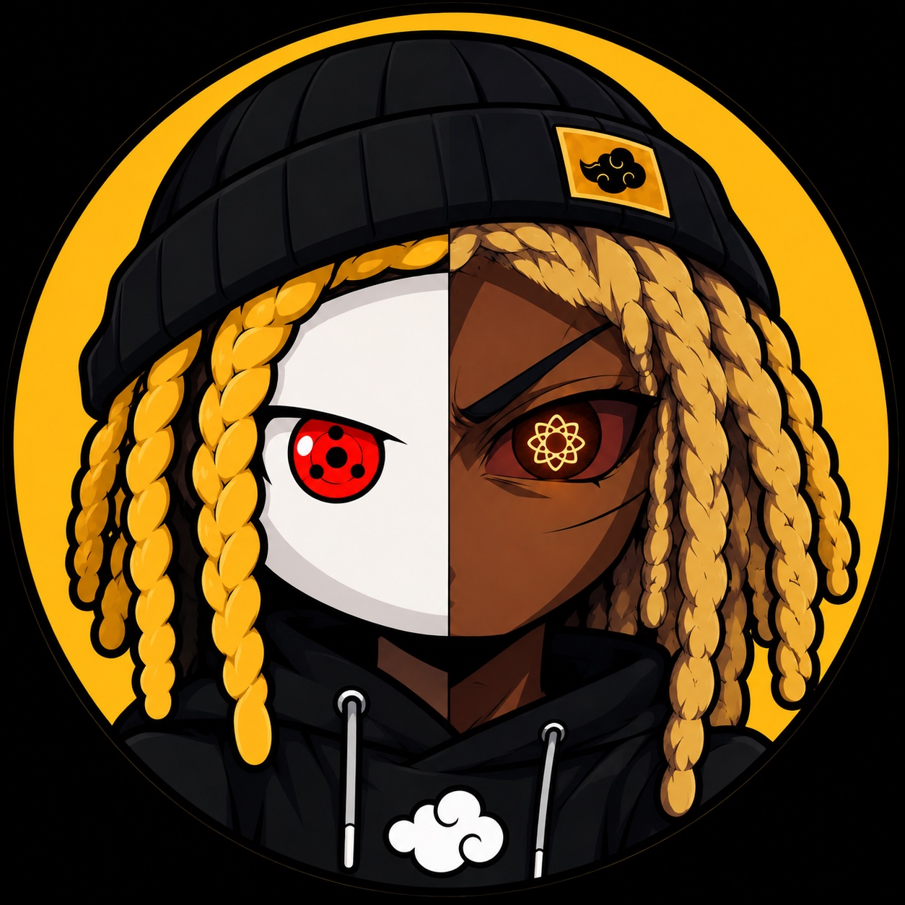
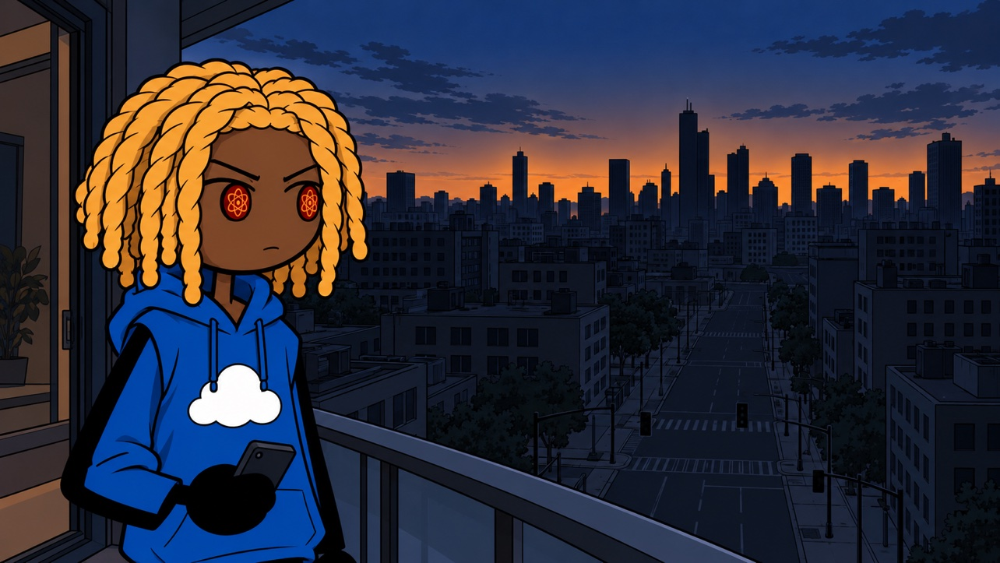

# Shamz Narrated Block Pipeline

Build a narrated animated episode one block at a time, with approval at every stage, so nothing bad reaches
the next stage. This is the pipeline behind the Shamz Survives episodes. One block is one self-contained
stretch of story, with its own shots, stills, voice, and sound.



## What it does

1. **Locks the character sheets and the world look** before anything is generated.
2. **Approves the script**, then passes the shot list through the gates: the movie test, shot length, camera
   variety, no repeats.
3. **QCs every still individually** against its locked sheet, zoomed in.
4. **Records the voice** in small checkpointed chunks, one voice job at a time.
5. **Adds scene-matched sound**, assembles the block, and QCs it shot by shot against the shot list.

## The look

Flat 2D, bold outlines, flat colours, and a deep-blue night palette with a strong tint even in the morning.
Warm amber lamp light is an accent only. No photographic shading, no textured realism. The character sheets
and the world look are locked before any generation begins, and the locked sheet is the single source of
truth. A generated image is never a substitute for it.



## How a run works

1. Lock the sheets and the world look, and record the paths.
2. Approve the script. Narration is story only: it moves the story, it does not describe what the picture
   already shows.
3. Write the shot list, run it through the gates, and get it approved. If the grammar is wrong, redo it at
   shot-list stage, never patch after generation.
4. Generate and QC one unique still per shot.
5. Record the voice in chunks, add sound, and assemble.
6. QC the block against the shot list, then deliver it for approval.

## What you need

- Locked character sheets (one per character) and a locked world look.
- An approved script.
- A voice pipeline that records in checkpointed chunks.
- A still generator and an assembly tool.

## Install

From the folder you want to work in, give your agent the prompt in
[SETUP_PROMPT.md](../../SETUP_PROMPT.md), or run the installer yourself:

```bash
git clone --depth 1 https://github.com/shamz4200/agent-skills /tmp/agent-skills
bash /tmp/agent-skills/install.sh .
```

Then start your agent from that folder and ask it to use the narrated animated block pipeline skill.

## What's in the folder

| Path | What |
|---|---|
| `SKILL.md` | The pipeline the agent follows |
| `README.md` | This how-to guide |
| `LICENSE` | The MIT licence, which must stay with these files |
| `hero.jpg` | The hero image for this guide |
| `style.jpg` | The locked look: dusk-lit balcony, deep-blue night palette |

## Rules it follows

- One block at a time, approval at every stage gate. A stage that fails its gate is fixed in that stage,
  never patched after assembly.
- One unique still per shot, never reused. No shot over 8 seconds, no repeated verb, pose, or still.
- Character-exact in every frame, or the still is regenerated. Drift is never carried forward as accepted.
- The movie test: environment, object, and other-character shots carry at least half of each block.
- Never send a block for review with off-model shots or repeated scenes.
- Never claim a block is done until it has been inspected against the true reference.

## Licences

- MIT: see `LICENSE` in this folder, which must stay with these files.
