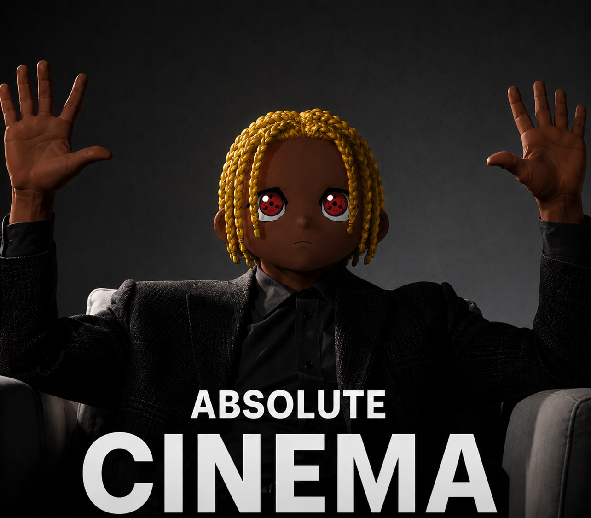

# Shamz Narrated Block Shot List Gates

Gate a narrated video block shot list on measured narration rate, story-only narration, and varied camera
angles, before any stills or narration are made. A list that fails a gate is fixed at shot-list stage,
never patched after generation.



## What it does

1. **Measures the delivered narration rate** from a timed transcript before writing duration estimates.
2. **Keeps narrator text story-only**, with motion and camera instructions in the verb and camera columns.
3. **Adds a camera angle column** to every shot and counts front-facing shots.
4. **Fails the list** when front-facing shots dominate or neighbouring shots repeat the same angle.
5. **Presents the shot list for a verdict** before any stills, narration, or segment work starts.

## How a run works

Measure the narration rate from the timed transcript and recalculate every shot duration from that rate and
the timed words for the shot. Scan the narrator text for repeated motion words and rewrite any line that
only describes a hand, arm, step, or pose. Assign a camera angle per shot, count front-facing shots, and
check shot count, word count, duration, presence split, and angle count. Present the list for a verdict
before generating stills, recording narration, or building a segment, and do not start a later block until
the fixed block passes its flow verdict.

## What you need

- A timed transcript of the delivered narration.
- The shot list with narrator text, verb, and camera angle columns.
- The measured words per minute and its source file, recorded in the shot list header.

## Install

From the folder you want to work in, give your agent the prompt in
[SETUP_PROMPT.md](../../SETUP_PROMPT.md), or run the installer yourself:

```bash
git clone --depth 1 https://github.com/shamz4200/agent-skills /tmp/agent-skills
bash /tmp/agent-skills/install.sh .
```

Then start your agent from that folder and ask it to use the narrated block shot list gates skill.

## What's in the folder

| Path | What |
|---|---|
| `SKILL.md` | The gates the agent follows |
| `README.md` | This how-to guide |
| `LICENSE` | The MIT licence, which must stay with these files |
| `hero.jpg` | The hero image for this guide |

## Rules it follows

- Never use an assumed narration rate for an estimate.
- Never floor a shot duration to a pacing band, and never pad narration with silence to reach a target
  length.
- Use a front-facing angle only when the story needs a direct face, a reaction, or a direct address.
- Rebuild any shot boundary gap over about one second that is not a deliberate pause.
- Treat a repeated motion phrase across many shots as a failure of the list, not a style choice.

## Licences

- MIT: see `LICENSE` in this folder, which must stay with these files.
