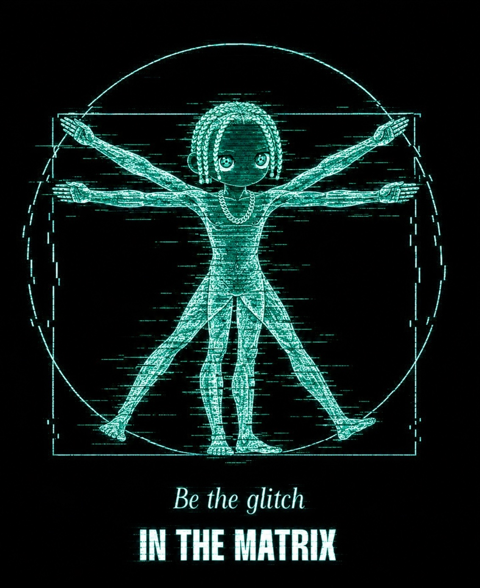

# Shamz Script Aware Loop Check

Catch repeated phrases in a narration transcript without flagging scripted repetition or numbers spoken in
different forms. A list in the script is not a loop, and a real loop is never cleared on a tool verdict
alone.



## What it does

1. **Converts every digit token in a flagged transcript window to its spoken word form** before comparing
   with the script.
2. **Checks whether each repeat carries a different payload** and follows the script in order.
3. **Clears a flag only when the phrase is in the script** and each repeat matches a distinct script item
   in order.
4. **Fails a flag when the phrase is absent from the script**, or when repeats cluster tightly with the
   same payload.
5. **Records the normalized phrase, its script match, and repeat timestamps** with every cleared flag.

## How a run works

Normalize number forms in each flagged window, then compare the converted phrase against the script in that
one normalized form. Check whether each repeat carries a different payload and follows the script in order;
clear the flag only when every repeat matches a distinct script item in order. Prove a false positive with
clip-level evidence before clearing a clustered flag, checking each repeat against its own script passage
and timestamp. Keep the flag as a fail when the evidence does not prove a false positive, and never clear a
flag on a tool verdict alone.

## What you need

- The narration transcript with timestamps.
- The script the narration was read from.
- The original suspect report, kept with the episode record.

## Install

From the folder you want to work in, give your agent the prompt in
[SETUP_PROMPT.md](../../SETUP_PROMPT.md), or run the installer yourself:

```bash
git clone --depth 1 https://github.com/shamz4200/agent-skills /tmp/agent-skills
bash /tmp/agent-skills/install.sh .
```

Then start your agent from that folder and ask it to use the script aware loop check skill.

## What's in the folder

| Path | What |
|---|---|
| `SKILL.md` | The check the agent follows |
| `README.md` | This how-to guide |
| `LICENSE` | The MIT licence, which must stay with these files |
| `hero.jpg` | The hero image for this guide |

## Rules it follows

- Clear a flag only when the normalized phrase is in the script and each repeat matches a distinct script
  item in order.
- Fail a flag when the normalized repeats form a tight cluster under 60 seconds with the same payload, even
  when the phrase is scripted, unless clip-level evidence proves each repeat is a distinct scripted passage.
- Never discard the original suspect report when a flag is cleared.
- Never use a cleared list flag to skip another check.
- Run the loop check on the narration audio before assembly.

## Licences

- MIT: see `LICENSE` in this folder, which must stay with these files.
