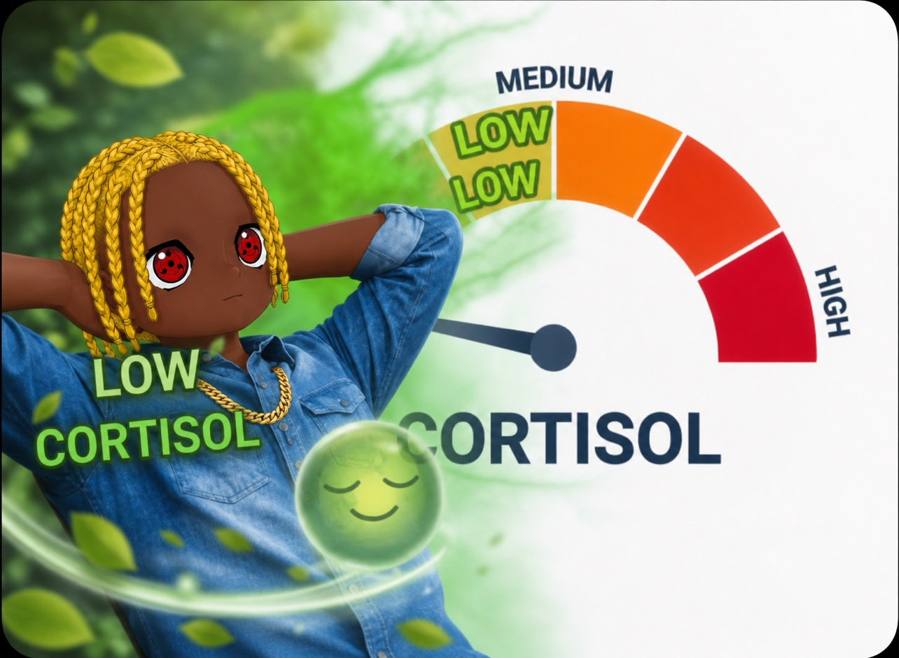

# Shamz Segment Audio Hygiene

Assemble multi-chunk narration without DC bursts, drift, or gaps, for any video segment built from separate
narration files. A segment that fails an audio check is rebuilt from the chunk stage, never patched.



## What it does

1. **Re-encodes every narration chunk to one common sample rate**, channel layout, and sample format.
2. **Rejects any chunk showing samples pinned at the negative full scale limit.**
3. **Cuts narration at word ends** measured from the timed transcript.
4. **Joins cuts with no added silence and no overlap**, padded or trimmed to exact beat boundaries.
5. **Verifies the assembled segment's duration, bursts, clicks, drift, and voice presence** before delivery.

## How a run works

Re-encode all chunks to one common format and reject any chunk with the pinned-sample pattern. Cut at word
ends from the timed transcript, join with no gaps or overlap, and pad or trim each chunk to its exact beat
boundary, restoring intentional holds in the timeline after the join. Measure the assembled duration against
the expected beat total, scan the start, middle, and end for bursts, clicks, and drift, and confirm voice
presence with a transcript sample. Rebuild from the chunk stage when a check fails.

## What you need

- The narration chunk files and their timed transcript.
- The expected beat total for the assembled segment.
- The original chunk files, kept until the assembled segment passes.

## Install

From the folder you want to work in, give your agent the prompt in
[SETUP_PROMPT.md](../../SETUP_PROMPT.md), or run the installer yourself:

```bash
git clone --depth 1 https://github.com/shamz4200/agent-skills /tmp/agent-skills
bash /tmp/agent-skills/install.sh .
```

Then start your agent from that folder and ask it to use the segment audio hygiene skill.

## What's in the folder

| Path | What |
|---|---|
| `SKILL.md` | The method the agent follows |
| `README.md` | This how-to guide |
| `LICENSE` | The MIT licence, which must stay with these files |
| `hero.jpg` | The hero image for this guide |

## Rules it follows

- Never cut at a fixed duration grid; cut at word ends.
- Never patch the assembled file when a chunk is bad; regenerate or re-encode the chunk from its source.
- Never present a segment that failed an audio check as a pass.
- Split long beats at sentence boundaries to keep each cut clean.

## Licences

- MIT: see `LICENSE` in this folder, which must stay with these files.
