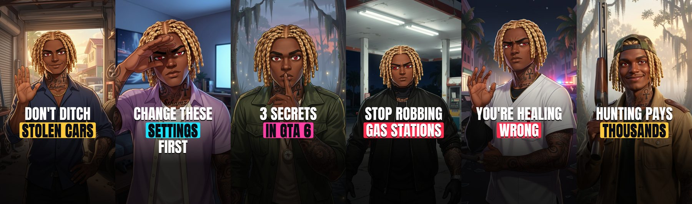
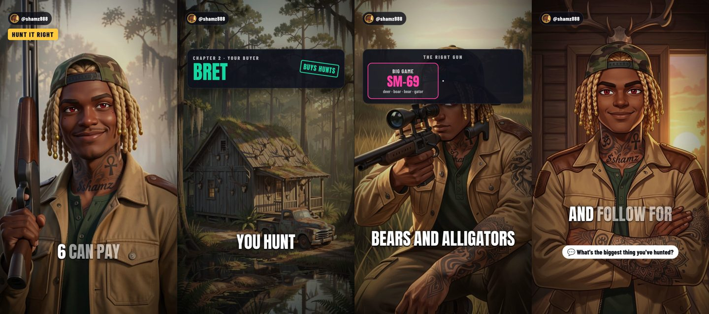
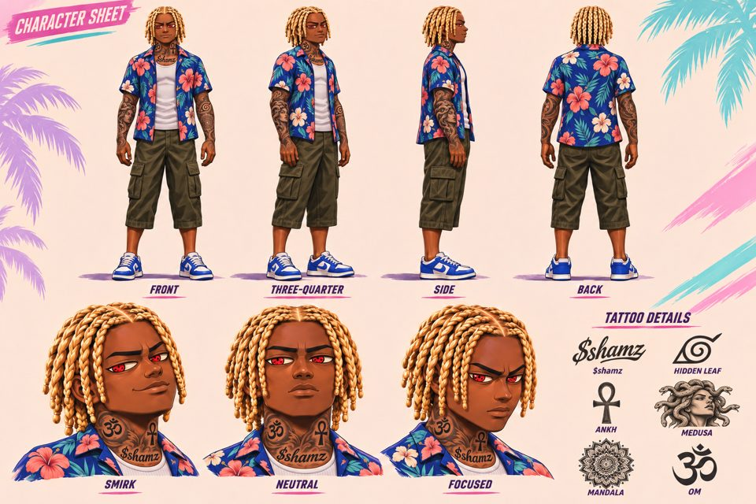
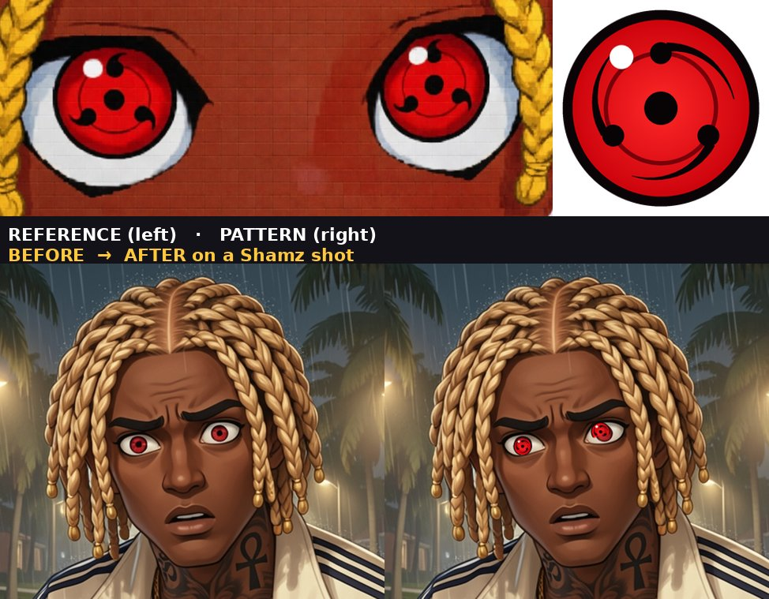
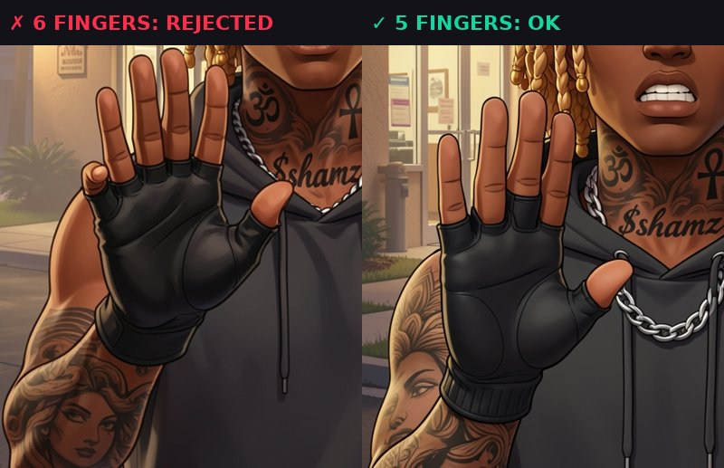
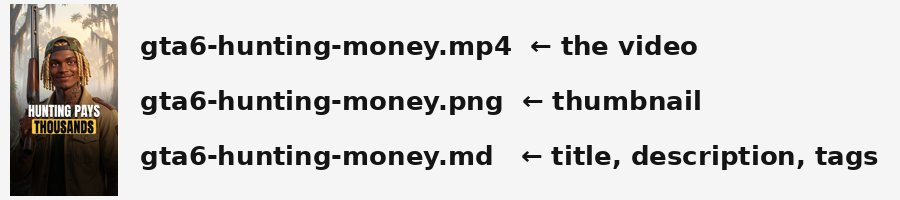
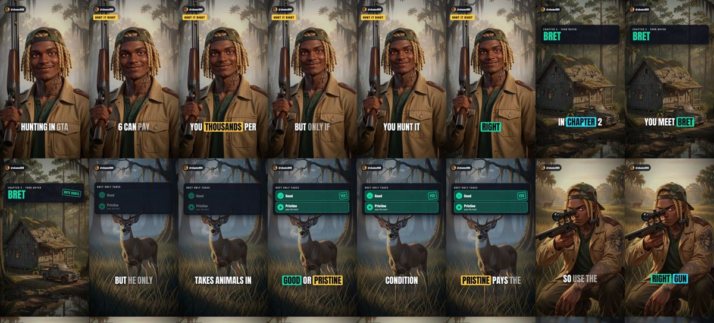

# Shamz Quick Guide: GTA 6 Shorts, 6 a day

Vertical 30-45 second GTA 6 guides, tips and news for **@shamz888** (YouTube Shorts, TikTok, Instagram Reels).
Shamz hosts every one in a brand-new outfit, in the owner's own voice.

---

## What a Short looks like

- **9:16, 1080x1920, about 40 s, about 150 words a minute.**
- **Hook in under 3 seconds:** a mistake the viewer is making ("You're healing wrong in GTA 6").
- **Then:** one surprising number, the specifics, a twist, one action step.
- **Ending:** a comment question and "follow for a GTA 6 tip every day".
- **Something new on screen every second:** cards, counters, stamps, maps, controller prompts.
- **Captions:** big, all caps, with the key word in a coloured box.

---

## Shamz

- The **original painted Shamz** (`cast/shamz-gta-sheet.png`).
- **Always kept:** golden braided locs with gold beads, the Om / ankh / $shamz neck tattoos, the Medusa and mandala
  sleeve, the Hidden Leaf mark.
- **A brand-new outfit every video.** Log each one so none repeats.

### His eyes: always exactly like this

- **The pattern:** a bright red iris, black outer ring, thin inner ring, black pupil, three curled tomoe, and a white
  glint at the top left.
- **Reference:** `cast/shamz_eyes_reference.png`.
- **Applied automatically:** `bulk/tools/eyes.py` paints them on every Shamz image.
- **Check:** zoom in on both eyes in every image.

### Hands: always five fingers

- **Zoom in on every hand** in every image and count the fingers.
- **Also check** for brand logos and garbled lettering.
- **Regenerate any image that fails** before building.

---

## The rules (from the owner)

| | Rule |
|---|---|
| 📅 | **6 Shorts a day**, one batch at 11:11 UK time, sent together |
| 🖼️ | **New images for every video**, never reused from another video |
| 👕 | **New outfit every video** |
| 👁️ | **Eyes exactly like the reference** · ✋ **five fingers** · 🚫 **no logos** |
| 🎵 | The owner's own music, in rotation, kept quiet under the voice |
| 🔎 | **Max SEO**: keyword-first title, tags, pinned comment, captions for all 3 platforms |
| #️⃣ | **#shamz is always a hashtag** |
| 📝 | **Never put sources in descriptions** (they stay in the script) |
| ✅ | **Check every video frame by frame before sending**, and fix first |

---

## What gets delivered

Each video comes as **three files with the same name**: the video, the thumbnail, and the description pack (titles,
descriptions, tags and captions for every platform).

---

## The quality check

Every finished Short becomes a board of one frame per second, read by eye before it's sent. Look for:
- empty stretches longer than about 2 seconds
- anything covering his face
- captions that are hard to read
- the follow buttons blocked by the app's own buttons at the bottom
- hands and eyes in the first frame and the thumbnail

---

## How to make a batch

**Full step-by-step guide:** [`bulk/README.md`](bulk/README.md). The short version:

1. **Research** 6 fresh, checkable GTA 6 tips or news stories, and write a 100-word script for each.
2. **Voice** them in the owner's voice (`bulk/tools/voice.py`).
3. **Make the images:** 3 Shamz poses + 3 scenes per video (`bulk/tools/plates.py`, which also paints the eyes).
   Check the hands and eyes.
4. **Stage** each Short: shots and on-screen cards timed to the words (`bulk/src/eps/<slug>.ts`).
5. **Build** each one: render, thumbnail, check board, music mix (`bulk/tools/build.sh`).
6. **Check** every board, fix, rebuild.
7. **Deliver** the matching files.

---

## What's in this folder

| Folder | What's inside |
|---|---|
| `bulk/` | **Start here.** The engine, tools, fonts, setup and full batch guide |
| `cast/` | Shamz's character sheet and the eye reference |
| `example/batch/` | Two finished Shorts: script, image plan, description pack, thumbnail |
| `example/eyes/` | Eye before/after and a preview sheet |
| `example/` | Video #1: script, images, thumbnail, check board |
| `engine/`, `tools/` | The original single-Short version (kept for reference) |
| `STUDY.md` | The study of the reference video this style came from |
