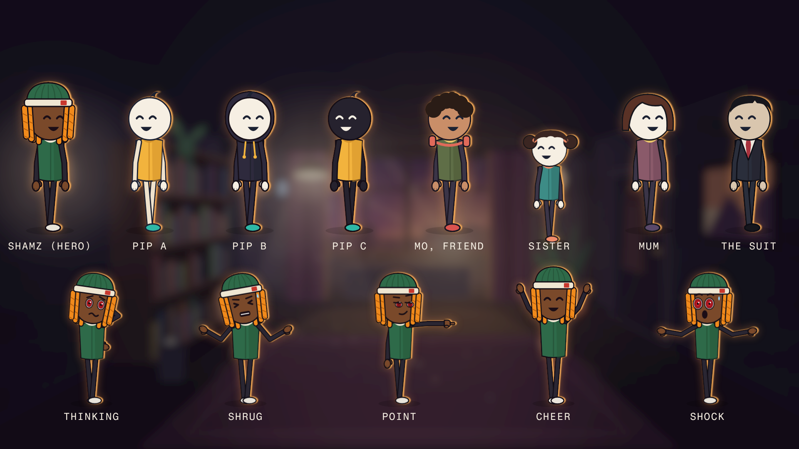
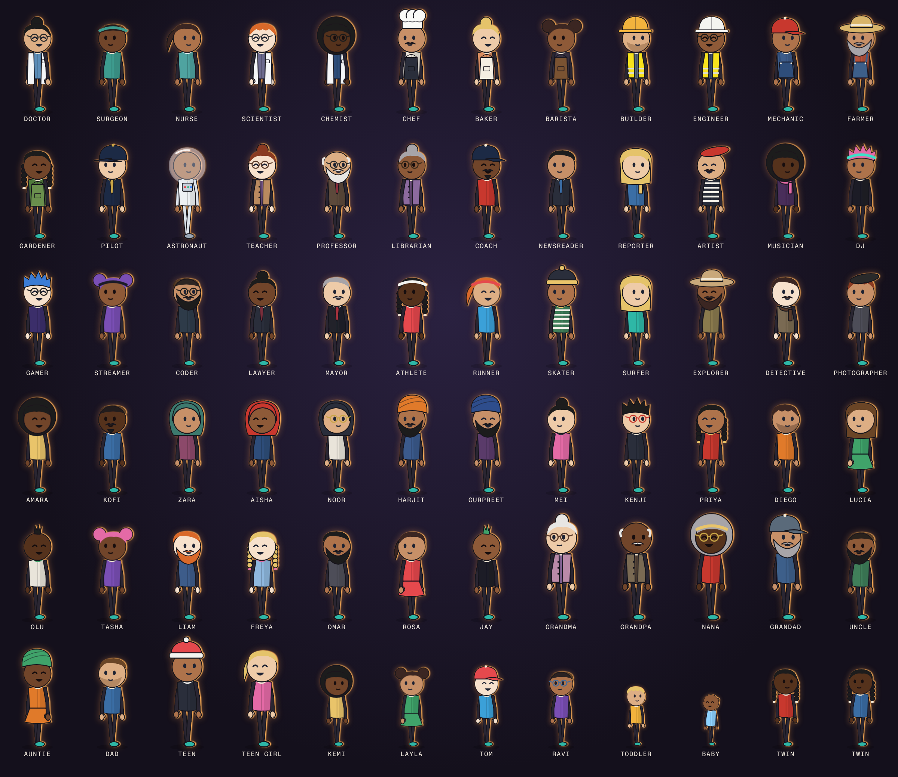

# Shamz What If

Type one line, "What if you could rewind 10 seconds?", and get a finished 15-25 second animated episode starring
Shamz, in the dusk-lit stick-figure "What If" style.

Every frame is drawn in code: the agent writes the scenes as SVG and Remotion renders them. The voice and the sound
effects come from ElevenLabs. No image model, no video model, no drawing.



## What it does

1. **Writes the script** on the seven-beat What If formula: a cold open of quick demos, the premise as a title card,
   the fun, and a turn built on one real, checked fact.
2. **Voices it** with ElevenLabs, with word timings, and tightens the pauses to the genre's pace.
3. **Lays out a shot list** on the words, at the genre's pace (about 27 cuts a minute in the opening and up).
4. **Renders a storyboard** of one still per shot, before any animation.
5. **Checks its own stills** against an 11-point checklist and fixes what reads wrong.
6. **Animates** Shamz and the cast on one rig, in rooms drawn in real perspective, lit by their own lamps and windows.
7. **Generates and syncs the sound:** an effect on every action, ambience per place, a music bed, levels set against
   the voice.
8. **Masters** the episode to -14 LUFS and reports what it cost.

## The cast

- **Shamz**, the hero: brown skin, red ringed eyes, orange twist locs, a green beanie with a cream band and a red tag.
  He is "you" in every script.
- **The core cast:** Pip (three looks), Mo the friend, the sister, mum and the suit (`engine/rig.tsx`).
- **The wide cast:** 72 more characters for friends, family, crowds and experts: doctors, chefs, builders,
  astronauts, teachers, grandparents, kids, and friends with a full range of skin tones, hair, hijabs, turbans,
  beards and glasses (`engine/crowd.ts`).



Because every character is code, not a generated image, each one looks the same in every shot. A new character is
one line in `engine/crowd.ts`, built from the wardrobe in `engine/wardrobe.tsx`.

## What you need

- Claude Code, OpenCode, or another coding agent
- Node 18 or newer, ffmpeg (with ffprobe), Python 3.9+ with `numpy` and `Pillow`
- An ElevenLabs API key in your environment or a `.env` file as `ELEVENLABS_API_KEY`. An episode uses roughly 150 to
  250 credits. ElevenLabs' free plan is for non-commercial use and asks you to credit ElevenLabs, so check its terms
  before you monetise.

## Install

From the folder you want to make episodes in, give your agent the prompt in
[SETUP_PROMPT.md](../../SETUP_PROMPT.md), or run the installer yourself:

```bash
git clone --depth 1 https://github.com/shamz4200/agent-skills /tmp/agent-skills
bash /tmp/agent-skills/install.sh .
```

Then start your agent from that folder and type `/what-if` or `/shamz` and your idea, for example
`/what-if What if you could see one minute ahead?` (or just ask: "Make a Shamz What If episode: what if you could
pause everyone but you?"). The first run copies the studio into `what-if-studio/` and
installs it, which adds a few minutes.

To see the examples first, from `studio/` after `npm install`: `npx remotion studio src/index.ts`, then open `Rewind`
or `CopyPaste`, or the `Cast` and `Crowd` sheets.

## What's in the folder

| Path | What |
|---|---|
| `SKILL.md` | The pipeline the agent follows |
| `references/` | The formula, the measured look and checklists, the building blocks (cast, wardrobe, sets), sound, traps |
| `studio/` | The Remotion project: the engine (rig, wardrobe, wide cast, sets, light, UI) and two example episodes |
| `scripts/` | voice, plan, stills, board, sfx, mixcheck, motiongrid, master |
| `opencode/commands/`, `claude/commands/` | The `/what-if` and `/shamz` start commands for OpenCode and Claude Code |

## Rules it follows

- Shamz is the hero of every episode; the supporting cast is original. Never a channel's own hero, nothing that
  resembles a famous cartoon character.
- Original stories: the formula is shared, the episodes are your own.
- Every fact in a script is worked out and sourced before it's voiced.
- Keys are read by name from the environment or `.env` and never printed.

## Licences

- MIT: see `LICENSE` in this folder, which must stay with these files.
- Fonts load from Google Fonts at render time (Bricolage Grotesque, Fragment Mono, Kalam: SIL Open Font License).
- Remotion is free for individuals and companies of up to three people; larger companies need a Remotion company
  licence.
- Voices and sound effects are generated by your ElevenLabs account under its terms.
