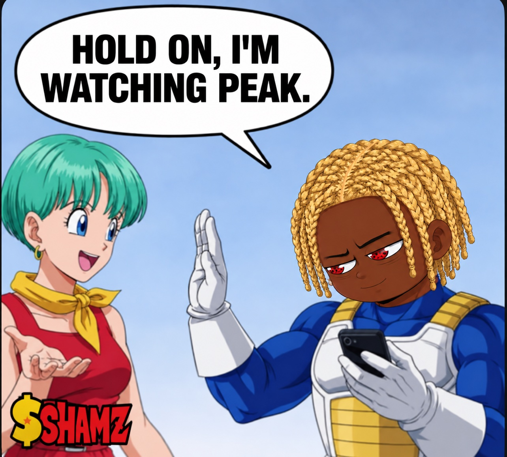

# ShamzClipz

Send a VOD link from your own livestream and get Shorts cut from it, in the Shamz funny-caption format.

ShamzClipz finds the viral and funny moments in a long Twitch or Kick VOD, cuts them into 15–60 second clips,
and renders them the Shamz way: 720x1280 vertical, gameplay letterboxed in the middle, funny written captions
at the top and bottom in the black bars, never over the gameplay.



## What it does

1. **Takes your VOD.** A Twitch or Kick link from your own stream, or a local MP4 of your own gameplay. Own
   streams only, never another creator's footage.
2. **Downloads audio first.** For a long VOD it pulls the audio track only, so a 3-hour stream is scanned
   without downloading gigabytes of video.
3. **Transcribes it.** Faster-whisper turns the whole stream into a word-timed transcript. YouTube sources
   use their own captions when available, which is faster.
4. **Scores the moments.** Sudden loudness jumps, raised voices, and a hype-word lexicon ("oh my god", "run",
   "police", "clip it") find the candidates. Deep mode adds optical flow for fast motion and explosions.
5. **Ranks and curates.** Duplicates and filler are dropped, and the shortlist is judged for a clear setup,
   real stakes, and an actual payoff.
6. **Cuts the chosen moments.** One clip per moment, starting 2–3 seconds before the payoff and ending right
   after the reaction lands.
7. **Renders in our format.** Funny written lines, top and bottom in the black bars, gameplay letterboxed in
   the middle. Never karaoke captions over the picture.
8. **Waits for your approval.** Nothing uploads until you have seen the exact finished file and approved it.

## The caption format

This is the Shamz caption standard, and ShamzClipz never breaks it:

- 720x1280 vertical, gameplay letterboxed in the middle.
- One funny top line and one funny bottom line per beat, in the black bars.
- Captions never sit over the gameplay.
- The lines are written funny, not a verbatim transcript.

## What you need

- Claude Code, OpenCode, or another coding agent
- Python 3.12, ffmpeg (with ffprobe)
- The ShamzClipz finder engine installed locally (see below)
- No Ollama, no paid API, no large Whisper model. The agent judges the shortlist itself, and transcription
  uses the small faster-whisper model.

## Set up the moment finder

ShamzClipz finds moments with its finder engine. Install the engine once before your first run:

```bash
git clone https://github.com/iamajmeena/neonclipping
cd neonclipping
python3 -m venv .venv
.venv/bin/pip install -r requirements.txt
```

No Ollama and no large Whisper model needed. The skill uses the small faster-whisper model and the agent
judges the shortlist itself.

## How a run works

1. Send the agent your VOD link the same night or the next morning, because Twitch VODs expire.
2. The agent scans the VOD, builds a timestamp log with an in time, out time, and one-line description per
   moment, and shows you the log first.
3. You pick the moments, or the agent picks the strongest ones.
4. The agent cuts and renders them, then shows you each exact finished file with its duration and title.
5. You approve the file, then it posts to YouTube, Instagram, and TikTok.

For a stream that is live right now, ShamzClipz can also watch chat and cut around chat spikes, since chat
explodes about 24 seconds after the moment happens.

## Install

From the folder you want to work in, give your agent the prompt in
[SETUP_PROMPT.md](../../SETUP_PROMPT.md), or run the installer yourself:

```bash
git clone --depth 1 https://github.com/shamz4200/agent-skills /tmp/agent-skills
bash /tmp/agent-skills/install.sh .
```

Then start your agent from that folder and send it a VOD link, for example "Cut Shorts from this VOD:
https://www.twitch.tv/videos/...".

## What's in the folder

| Path | What |
|---|---|
| `SKILL.md` | The pipeline the agent follows |
| `README.md` | This how-to guide |
| `LICENSE` | MIT licence, which must stay with these files |
| `hero.jpg` | The hero image for this guide |

## Rules it follows

- Own streams only. Never clip another creator's footage.
- Never download a multi-hour video whole just to scan it.
- Never run transcription while a voice job is running.
- Delete the downloaded VOD and source audio after the clips are cut and approved. Keep only the final Shorts
  and the timestamp log.
- Nothing uploads without approval of the exact file.

## Licences

- MIT: see `LICENSE` in this folder, which must stay with these files.
- The finder engine is MIT-licensed open-source software, used here for finding moments only. Its built-in
  caption styles and layouts are not used.
